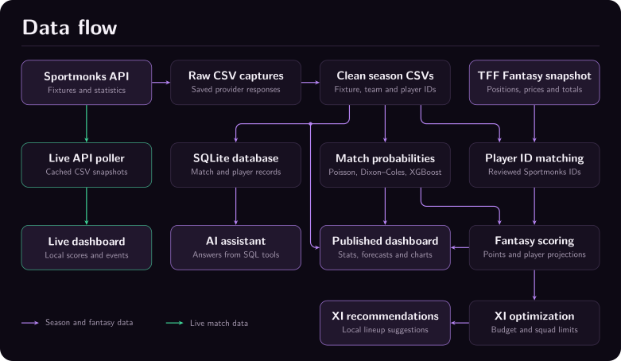
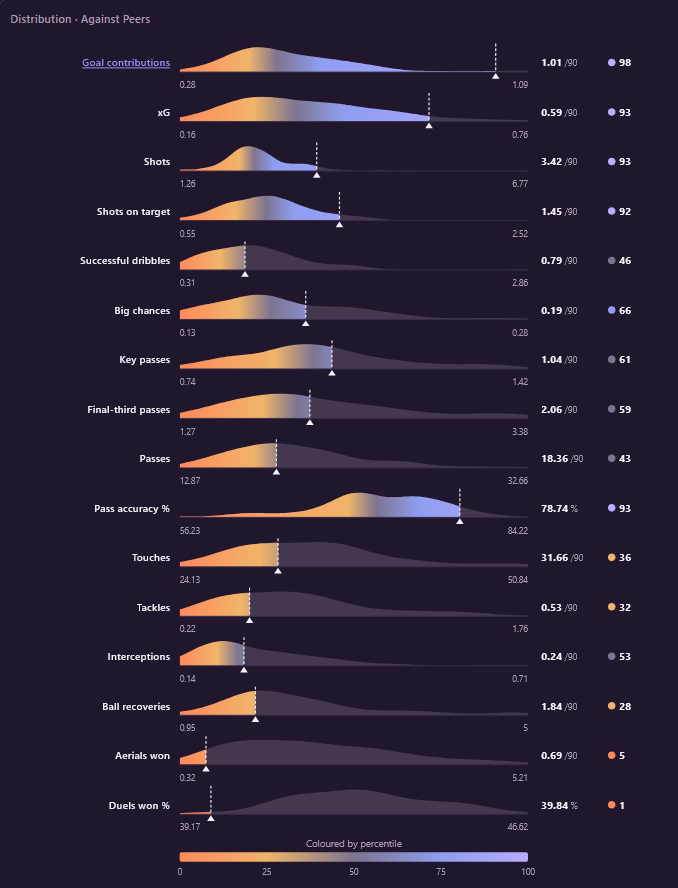
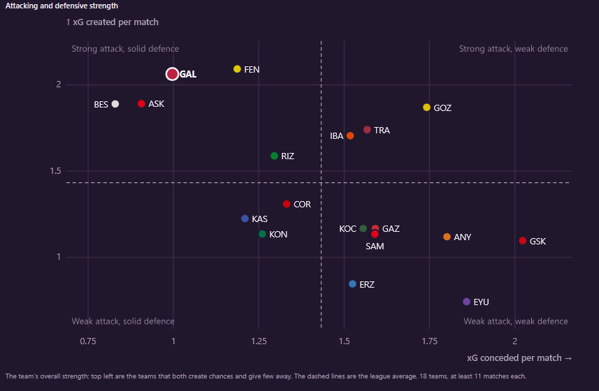
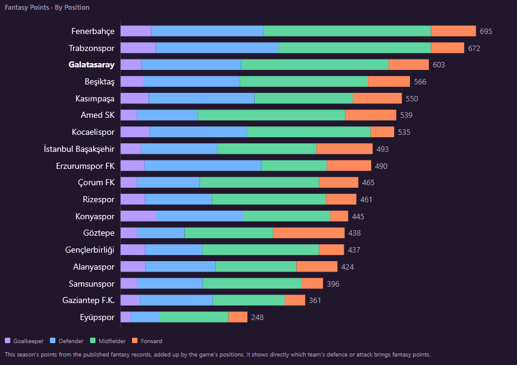

# Fantezi Analiz

[Explore the live website](https://fantezianaliz.com/)

Fantezi Analiz is my Süper Lig data analysis and fantasy football project. I built it to help visitors compare players and make more informed choices for TFF Fantezi Lig. The website brings together historical and live football data, player analysis, match probabilities, fantasy projections, interactive dashboards, and an AI assistant.

The live website is the product demo. This repository shows how I collect and prepare the data, analyze it, and turn it into features people can explore. The public website uses prepared data and a Cloudflare chatbot endpoint. Live match polling and server-side XI recommendations are available in the local version.

## Dashboard preview

*Local dashboard simulation from the first 39 seconds of a recording, played at 2.5× speed. This is a demonstration, not a real live match.*

## The problem

Picking a fantasy XI means comparing players with different prices, positions, opponents, playing-time risks, and incomplete statistics. Season totals alone do not show who is likely to help in the next matchweek. I built Fantezi Analiz to connect the underlying data to that decision while showing missing coverage and model uncertainty.

## What I built

| Area | My work | Code and details |
| --- | --- | --- |
| Data collection, cleaning, and analysis | Collected Sportmonks data, reviewed TFF player identities, prepared analysis-ready CSVs, reconstructed fantasy points, and generated projections. | [Data pipeline](docs/portfolio/data-pipeline.md) |
| Live API data | Built a separate local feed for match scores and events with bounded polling and explicit unavailable states. | [Live match data](docs/portfolio/live-match-data.md) |
| Match probabilities and odds | Implemented and evaluated Poisson and XGBoost models; converted outcome probabilities into implied fair odds. | [Match probabilities and fair odds](docs/portfolio/match-probabilities.md) |
| Fantasy scoring and XI optimization | Checked reconstructed season totals against TFF and optimized an XI under budget, formation, and club limits. | [Fantasy scoring and XI optimization](docs/portfolio/fantasy-scoring-and-xi-optimization.md) |
| Visualizations | Created player peer distributions, team comparisons, radar charts, and match-flow views. | [Player analysis and visualizations](docs/portfolio/player-analysis.md) |
| Dashboards | Built dashboards for matches, players, clubs, forecasts, and fantasy squad building, with light and dark modes. | [Fantasy football dashboards](docs/portfolio/fantasy-football-dashboards.md) |
| AI assistant | Built local and public chat endpoints that answer statistics questions using database tools. | [AI assistant for football statistics](docs/portfolio/ai-assistant.md) |

## Data flow

[LaTeX source](docs/media/data-flow.tex)

Sportmonks is the primary football data provider. TFF Fantasy supplies separate fantasy prices, positions, and totals. I join the sources through reviewed Sportmonks player IDs; ambiguous name matches stay unresolved until reviewed. The pipeline keeps provider captures in `data/raw`, rebuildable work in `data/temp`, and website-ready CSVs in `data/final`.

## Data analysis and visualizations

I use the cleaned data to compare players with relevant peers, examine clubs' attacking and defensive profiles, and summarize fantasy scoring by position. These example views come from the dashboard; their values reflect the data available when the screenshots were captured.

### Player comparison

The distribution view places a player's statistics against a peer group and shows percentiles alongside the underlying values.

### Team strengths

The scatter plot compares chances created with chances conceded per match, making different attacking and defensive profiles visible.

### Fantasy points

The stacked bars show each club's recorded fantasy points split by goalkeeper, defender, midfielder, and forward.

## Explore the project

Start with the [live website](https://fantezianaliz.com/) to see the dashboards. Explore the [data pipeline](src/run_pipeline.py), [odds model](src/odds/run.py), [website source](src/web/index.html), and [chatbot code](src/chat/assistant.py) for the main parts of the implementation. Model probabilities and fair odds are estimates, not bookmaker prices or a guarantee of fantasy results.
