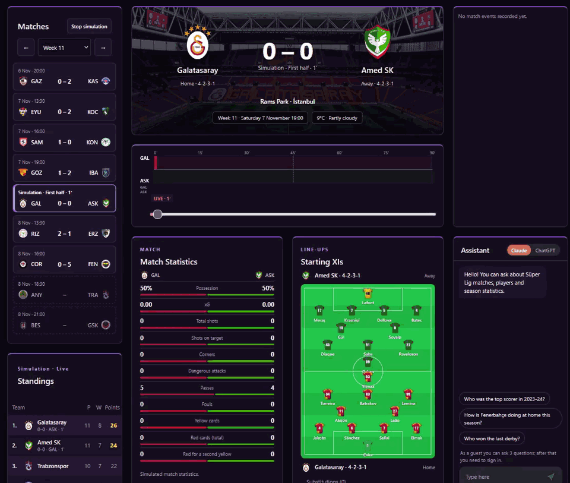
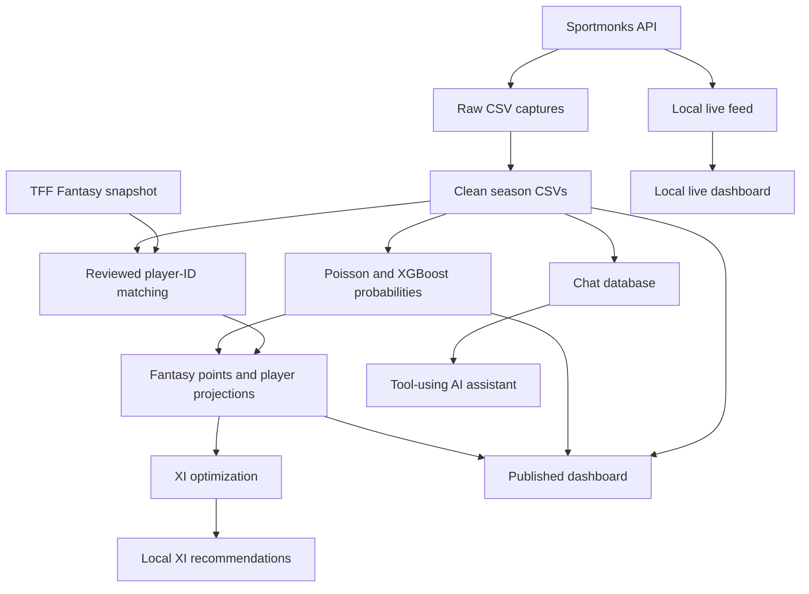

# Fantezi Analiz

**A Süper Lig data and fantasy football project I built from collection to decision-making.** It brings together historical and live football data, reviewed player identities, match probabilities, fantasy projections, interactive dashboards, and a database-backed AI assistant.

**[Explore the live website](https://fantezianaliz.com/)** · [Squad Builder](https://fantezianaliz.com/index.html?view=builder) · [Matchweek analysis](https://fantezianaliz.com/index.html?view=matchweek) · [Player statistics](https://fantezianaliz.com/index.html?view=statistics)

The live website is the product demo. This repository explains how I built it and where each result comes from. The public website serves prepared season CSVs and a Cloudflare chatbot endpoint. The local version also supports an on-demand Sportmonks live match feed and server-side XI recommendations; those two request-time features are not part of the public files-only build.

## Explore the live dashboard



*Local dashboard simulation: the first 39 seconds of a recording, played at 2.5× speed (15.6 seconds). This is a demonstration, not a real live match.*

Start on [Home](https://fantezianaliz.com/index.html?view=home) to open a saved match and inspect its timeline, statistics, lineups, and team comparisons. Then try [Matchweek](https://fantezianaliz.com/index.html?view=matchweek) for pre-match probabilities, [Player Statistics](https://fantezianaliz.com/index.html?view=statistics) for peer comparisons, and [Squad Builder](https://fantezianaliz.com/index.html?view=builder) to assemble a fantasy XI. The public pages use published data; an on-demand live-match demonstration requires the local server and provider access.

## The problem

Picking a fantasy XI means comparing players who have different prices, positions, opponents, playing-time risks, and incomplete statistics. A table of season totals does not answer who is likely to help **next matchweek**. I built Fantezi Analiz to connect the underlying data to that decision while making missing coverage and model uncertainty visible.

## What I built

| Area | My work | Explore the code |
| --- | --- | --- |
| Historical data collection | A Sportmonks client with pagination, CSV caching, request limits, raw captures, and rebuildable season exports. | [Client](src/fetch/sportmonks.py) · [Downloader](src/fetch/download_season.py) |
| Live API data | A separate local match feed with bounded polling, a shared snapshot cache, and explicit unavailable states. It never overwrites saved results or forecasts. | [Live feed](src/web/live.py) · [Match centre](src/web/features/matchweek/live-centre.js) |
| Cleaning and analysis | Analysis-ready CSVs, reviewed TFF-to-Sportmonks player IDs, a reconstructed fantasy-points ledger, player projections, and a constrained XI optimizer. | [Identity matching](src/fetch/update_tff_players.py) · [Pipeline](src/run_pipeline.py) · [Optimizer](src/xi_optimizer/README.md) |
| Match probabilities and fair odds | Python models for home win, draw, and away win, including Poisson and XGBoost. The pipeline exports probabilities and their implied fair odds. | [Model and evaluation](src/odds/README.md) · [Implementation](src/odds/run.py) |
| Visualizations | Player and team radar charts, peer distributions, match-flow charts, and model diagnostics, each tied to a specific comparison. | [Radar methods](src/web/lib/radar.md) · [Team charts](src/web/lib/team-analysis.md) |
| Dashboards | A bilingual, light/dark website for matches, clubs, players, forecasts, and fantasy squad building. | [Website guide](src/web/README.md) · [Page source](src/web/index.html) |
| AI assistant | Python and Cloudflare versions of a chatbot that answer football-statistics questions through database tools rather than invented numbers. | [Chatbot guide](docs/chatbot/README.md) · [Tool queries](src/chat/tools.py) · [Public endpoint](functions/api/chat.js) |

## Data flow



Sportmonks is the primary provider. The TFF Fantasy table is a separate source for current fantasy prices, positions, and the game's own totals. Sportmonks player IDs are the join key. An ambiguous name match is reported for human review rather than assigned automatically. The pipeline keeps lossless provider captures under `data/raw`, rebuildable work under `data/temp`, and website-ready CSVs under `data/final`.

## From data to a fantasy decision

### Collect and check

The downloader saves the provider response as typed raw CSV rows, then exports rectangular tables for fixtures, teams, players, lineups, events, and statistics. The [season audit](src/fetch/audit_season.py) checks structural problems before modeling. Missing values remain distinguishable from recorded zeroes, and the [identity review](src/fetch/update_tff_players.py) keeps unresolved TFF players out of ID-based joins.

### Analyze and model

The [points ledger](src/points/README.md) reconstructs fantasy scoring per player-match from reviewed rules. [Player projections](src/player_projections/README.md) estimate the next matchweek's minutes and scoring components, then the [optimizer](src/xi_optimizer/README.md) selects a legal XI under budget, position, and club limits. These are estimates, not guaranteed fantasy points.

The [odds research](src/odds/README.md) compares Poisson and XGBoost against a simple outcome-frequency baseline. It uses chronological validation and a later held-out season, with log loss, Brier score, and calibration checks. The resulting `home_fair_odds`, `draw_fair_odds`, and `away_fair_odds` are reciprocals of model probabilities; they are **not bookmaker prices** or a claim of betting profit.

### Make the analysis explorable

The [live site](https://fantezianaliz.com/) lets visitors move from a match or club to player statistics and a fantasy squad. Charts reuse the same definitions across pages. The radar compares a player with an explicit peer population, accounts for small samples, and marks insufficient coverage rather than turning missing data into a score. The [distribution panel](src/web/features/statistics/distribution.md) and [team charts](src/web/lib/team-analysis.md) expose the comparisons behind the summary views.

The assistant answers questions about recorded Süper Lig statistics using a read-only chat database and named SQL tools. Its instructions require names, dates, scores, and numbers to come from those tools, and ask for clarification when a player or club name is ambiguous. The public `/api/chat` runs as a Cloudflare Pages Function with a D1 database; the local `/local-chat` uses SQLite. [The chatbot guides](docs/chatbot/README.md) document the steps.

## How I evaluate the work

| Question | Evidence in this project |
| --- | --- |
| Did collection produce usable seasons? | Download status, feed coverage, duplicate-ID checks, and [season audit](src/fetch/audit_season.py). |
| Did cleaning preserve the right identities? | Match reports, candidate lists, and explicit overrides from [TFF matching](src/fetch/update_tff_players.py). |
| Does reconstructed scoring agree with TFF? | A [reconciliation report](src/points/README.md) compares player totals against a dated TFF snapshot and separates timing gaps from scoring differences. |
| Are match probabilities useful? | The [odds backtest](src/odds/README.md) compares models with a baseline on later matches and inspects calibration. |
| Do projections help choose an XI? | The [projection backtest](src/player_projections/README.md) can compare accuracy and the actual points of model-selected XIs with simple selection baselines. A current result is needed before claiming an improvement. |
| Can the chatbot answer faithfully? | [Tool tests](tests/test_chat_tools.py), [cloud parity tests](tests/test_chat_cloud.py), and examples grounded in database rows. These do not by themselves establish an end-to-end answer-quality rate. |

The scoring reconstruction still has known bonus-point differences, and player projections are experimental. The repository does not include the provider dataset or generated research reports, so this README makes no current accuracy claim for the full fantasy pipeline. Model limitations and available evaluation methods are explained in the linked module guides.

## Website and deployment

The public website is built from checked-in website code and prepared CSVs, then deployed to Cloudflare Pages. [The update workflow](.github/workflows/update-site.yml) refreshes data and publishes a new static build; [research reports](.github/workflows/research.yml) run separately. The chatbot is the public site's request-time exception. Visitor accounts and profiles live in Supabase, outside the CSV analysis pipeline.

The local server can show provider live scores and compute XI recommendations on request. The public build displays saved matches, forecasts, statistics, and the interactive squad builder without exposing a Sportmonks token in the browser. The [website guide](src/web/README.md) describes the available pages and their data rules.

## Explore the repository

- [`src/fetch/`](src/fetch/) — Sportmonks and TFF acquisition, CSV exports, identity review, and SQLite build.
- [`src/points/`](src/points/) and [`src/player_projections/`](src/player_projections/) — fantasy scoring and next-matchweek estimates.
- [`src/odds/`](src/odds/) and [`src/xi_optimizer/`](src/xi_optimizer/) — match probabilities and constrained squad selection.
- [`src/web/`](src/web/) — dashboard pages, shared visualizations, local server, and static-site builder.
- [`src/chat/`](src/chat/) and [`functions/api/chat.js`](functions/api/chat.js) — local and cloud chatbot implementations.
- [`tests/`](tests/) — tests for ingestion, analysis, models, website rules, and chatbot behavior.

The full pipeline requires provider access and saved season CSVs, which are not committed. For local setup and the commands used by the working project, expand the reference below. Credentials belong in local `.env` or deployment secrets, never in this repository.

<details>
<summary>Full local workflow and data reference</summary>

## Super Lig data — Sportmonks with TFF Fantasy snapshots

Sportmonks is the primary football-data provider. TFF Fantasy table snapshots
are kept separately as a supplemental source and matched to Sportmonks player
IDs. Use **CSV for Python analysis and data exchange**, and **SQLite for the final dataset and SQL queries**. CSV fits these rectangular tables; JSON is more useful for nested API responses, which this project already preserves in typed raw CSV files.

## Local website

Run the local website from the project root:

```powershell
python src/web/serve.py --season 2026/2027
```

Open [http://127.0.0.1:8000](http://127.0.0.1:8000) and leave the terminal running. The page automatically loads the saved season CSVs from `data/final/sportmonks/2026-2027`. After your next download finishes, reload the page or click **Refresh saved data**; no file selection or code changes are needed. Maç Haftası also shows an on-demand live match centre using the local Sportmonks token while that view is visible. Add `--no-live` to disable provider requests. See [live match centre setup](src/web/README.md#live-match-centre). Stop the server with Ctrl+C.

**Home** shows the league points table on the left and fixtures on the right. **Player Tier List** groups players by average Sportmonks match rating, shows season totals, and opens full match statistics, including roster players with no appearances. You can still open `src/web/index.html` directly and select CSVs manually. See `src/web/README.md` for details. The public website is [fantezianaliz.com](https://fantezianaliz.com/).

## Python setup

Python 3.10+ is sufficient for the core scripts; they have no third-party package requirements. The optional browser exporter below requires Playwright. Keep your token in `.env`:

```dotenv
SPORTMONKS_API_TOKEN=your_token
```

## Match probability research

The separate research area is documented in [src/odds/README.md](src/odds/README.md).
It audits existing season CSVs and supports chronological comparisons of frequency,
Poisson, and XGBoost models. Research reports are saved in unique run folders
under `data/temp/odds`; they do not feed the website automatically.

```powershell
python src/odds/run.py coverage
```

Coverage uses the standard library. Backtests require the research dependencies
and at least five complete historical seasons; see the research README for commands.

## Workflow

Run from the project directory:

```powershell
# Refresh Sportmonks and rebuild the clean season CSVs
python src/fetch/download_season.py --season 2026/2027 --refresh

# Capture the current TFF table and update final/tff_fantasy/tff_players.csv
python src/fetch/export_tff_browser.py --season 2026/2027

# Rebuild fantasy points, projections, radar statistics, then the database
python src/run_pipeline.py --season 2026/2027
```

That third command is the one to run after every match. It rebuilds everything
the website reads, in order, and publishes nothing until every stage has
succeeded:

1. fantasy points from completed matches (`src/points`)
2. next-matchweek player projections (`src/player_projections`)
3. radar statistics for every saved season (`src/spider`)
4. SQLite (`src/fetch/build_database.py`), unless you pass `--skip-database`

Then reload the site.

Files:

```text
data/
  raw/                        # Lossless provider captures; never edited manually
    sportmonks/2026-2027/
      raw_fixtures/
      raw_resources/
    tff_fantasy/
      players_<timestamp>.csv
  temp/                       # Rebuildable working files; safe to delete at any time
    cache_csv/
    tff_fantasy/
      tff_player_match_report.csv
      tff_player_match_candidates.csv
    odds/runs/                # One folder per odds run
    points/runs/              # One folder per points ledger build
    player_projections/
      runs/                   # One folder per projection build
      backtests/              # Projection accuracy and selection scoring
    xi_optimizer/             # One folder per optimizer run, sweeps/ for full sweeps
    fantasy_pipeline/
  final/                      # Clean tables consumed by the website and database
    sportmonks/2026-2027/
      fixtures.csv
      player_match_stats.csv
      teams.csv
      players.csv
      squads.csv
      standings.csv
      fixture_scores.csv
      ...
    tff_fantasy/
      tff_players.csv
    points/
      player_match_points.csv
      player_season_summary.csv
    player_projections/2026-2027/
      player_projections.csv
      team_fixture_projections.csv
    fantasy_pipeline/2026-2027/
      pipeline_status.csv
    odds/
      predictions.csv
    xi_optimizer/2026-2027/     # after src/xi_optimizer/sweep.py
      player_opportunity_cost.csv
  superlig.sqlite             # Unified Sportmonks + TFF Fantasy database
config/                       # Permanent, manually reviewed decisions
  tff_player_overrides.csv    # Identity decisions
  tff_scoring_rules.csv       # Fantasy scoring rules, transcribed and checked
src/
  fetch/                      # Provider downloads, exports and the database build
  points/                     # Historical fantasy points ledger
  player_projections/         # Next-matchweek forecasts, plus backtest.py
  odds/                       # Match result probabilities
  xi_optimizer/               # Squad selection under the fantasy rules
  web/                        # Local website, organised by feature
    core/                     # Shell: boot, navigation, sidebar, club kits
    data/                     # Everything that reads a file: CSV parser, published analysis
    lib/                      # Shared drawing libraries: radar, team charts
    features/                 # One folder per page or panel
    styles/                   # Global appearance
    serve.py                  # Read-only local server
  run_pipeline.py             # Points, projections, radar statistics and SQLite in one publication
```

Every module publishes to `data/final/` and writes its working records to
`data/temp/`. Nothing writes anywhere else.

Provider code lives in `src/fetch/`, historical fantasy scoring in `src/points/`, player forecasts in `src/player_projections/`, and squad selection in `src/xi_optimizer/`. Season totals, rankings and ratings are computed in the browser, in `src/web/lib/` ([radar](src/web/lib/radar.md), [team charts](src/web/lib/team-analysis.md)) and `src/web/features/` ([distribution](src/web/features/statistics/distribution.md)). The website is organised by feature and is described in [src/web/README.md](src/web/README.md). `src/run_pipeline.py` connects the saved CSVs to every analysis and to SQLite. `src/player_projections/backtest.py` scores the forecasts against what actually happened and against model-free baselines; run it before trusting a selection. The provider scripts find `.env` and create `data/` at the project root regardless of the working directory. They also support module invocation from the project root, for example `python -m src.fetch.download_season --season 2026/2027`.

## Fantasy analysis pipeline

After downloading Sportmonks and refreshing the reviewed TFF player table, run:

```powershell
python src/run_pipeline.py --season 2026/2027
```

This command makes no provider calls. It rebuilds the ledger from completed
Süper Lig matches in all downloaded seasons, then forecasts the next complete
unstarted round using the new ledger and the current Sportmonks sidelined files.
Current TFF positions are used only for the season supplied with `--season`;
earlier seasons fall back to per-match Sportmonks positions. The TFF CSV has no
season column, so select the season belonging to that snapshot.

The pipeline stages the results and builds SQLite before publishing the website
CSVs. Each output is replaced atomically and carries a shared `pipeline_run_id`.
The completion marker is published last; the website rejects mixed generations
if a refresh overlaps publication. Leave downloaders and CSV editors idle while
the pipeline runs. Input fingerprints are checked again before publication.

To select a particular round, add `--matchweek 5`. To publish CSVs while keeping
SQLite unchanged, add `--skip-database`. If a database viewer has SQLite locked,
disconnect it before running the default pipeline. A season with no upcoming
complete round publishes an empty projection table instead of retaining old
forecasts. Run reports and preserved experimental runs live under
`data/temp/points`, `data/temp/player_projections`, and `data/temp/fantasy_pipeline`.
The code no longer depends on the old top-level `temp` folders.

Refresh or reload **Fantasy XI Builder** after the pipeline finishes. Expanding a
player uses reconstructed historical fantasy points and the next-fixture
projection, joined by Sportmonks player ID. These remain estimates: the historical
bonus reconstruction has known residual differences and the forecast model has
not undergone predictive backtesting. Old experimental forecasts are archived;
they are not automatically promoted to current website data.

`--reconcile-before YYYY-MM-DD` limits the comparison with the official TFF
snapshot to fixtures before an explicit date. Without a supplied cutoff, the
reconciliation report is marked provisional because source snapshots can differ
in timing. It does not change the full history used by the projection model.

See [points](src/points/README.md),
[player projections](src/player_projections/README.md) and
[XI optimizer](src/xi_optimizer/README.md) for model details and
standalone commands. Run the pipeline command above to publish a new matching fantasy generation.

## CSV conventions

`player_match_stats.csv` has one row per player per match and separate columns for available statistics. Standard metrics use lowercase names such as `minutes_played`, `shots_total`, and `goals`. The dedicated xG feed uses an `xg_` prefix such as `xg_expected_goals`. The two feeds can contain the same concept: do not add them together.

Long-format metric tables retain provider type IDs, metric names, sources, and values. Complex season totals become scalar columns such as `value.total` and `value.home`. Blank metric cells remain missing; numeric zero remains zero. Metric columns depend on what the provider returned. UTF-8 with a BOM preserves Turkish characters in common spreadsheet applications.

Raw CSV files preserve nested source records as typed scalar rows: `node_id,parent_id,key,kind,value`. Use the root-level tables for ordinary analysis; the raw files support complete source retention and rebuilding.

## SQLite build

`build_database.py` imports the clean Sportmonks CSVs with a `sportmonks_` table prefix and imports `data/final/tff_fantasy/tff_players.csv` as `tff_players`. It excludes status and validation reports. It infers INTEGER, REAL, and TEXT columns, preserves codes with leading zeroes as text, maps blank cells to SQL NULL, and adds primary keys and indexes to the main tables. Column names containing dots are retained and can be referenced with double quotes in SQL.

The fantasy pipeline also imports `points_player_match_points`,
`points_player_season_summary`, and `player_projections`. A standalone database
rebuild can include the already published fantasy generation with
`python src/fetch/build_database.py --season 2026/2027 --include-fantasy`.
Without that flag, the standalone command retains its provider-only behavior.

The build requires a completed Sportmonks download and the final TFF player table. It checks row counts and duplicate assigned player IDs, then writes a temporary database before atomically replacing `data/superlig.sqlite`. Unresolved TFF rows remain in `tff_players` with a blank/SQL NULL Sportmonks ID and their review status. If the build fails, the previous database remains. On Windows, disconnect the `superlig` data source in the database viewer before rebuilding; closing only its SQL editor tab may leave the SQLite file locked. Reconnect and synchronize it after the build. `import_log` records imported filenames, row counts, and timestamps.

To keep the existing database and write a separate one:

```powershell
python src/fetch/build_database.py --season 2026/2027 --output data/superlig-new.sqlite
```

## Optional commands you can run

### Learning HTML extraction from a saved TFF table

`src/fetch/parse_tff_table.py` reads a statistics table you manually copied into
an HTML or text file. It uses only the Python standard library and makes no
network requests. This standalone local exercise does not feed the Sportmonks
pipeline or the website.

```powershell
python src/fetch/parse_tff_table.py "C:\path\to\table.html"
```

The output is `data/raw/tff_fantasy/players.csv`. Use `--output PATH.csv` for another
destination, or `--overwrite` to explicitly replace an existing output.
The source file is preserved. The script separates the first cell into
`player_name`, `team_name`, and `position`, then pairs the remaining cells with
their headers. It validates column counts before writing UTF-8 BOM CSV.

`price_million_try` stores the displayed price in millions (12.0 for ₺12.0m);
`so_percent` stores percentage points (84.7 for 84.7%). Dashes become blank
cells and zero stays zero. Other headers retain their source abbreviations in
lowercase because the copied HTML does not include tooltip definitions.
Only copied rows and visible columns are available, so one table export must
not be assumed to contain the full catalogue. Player IDs are not inferred from
names or kit/logo filenames.

For paginated tables, select all desired columns using **Kolonlar**, clear
filters for a full catalogue, and keep the same columns, filters and sort order
while copying every page. Save each table's outerHTML into a separate UTF-8
file: `data/temp/tff_tables/page-01.html`, `page-02.html`, and so on. Keep only
the pages from one capture in that folder. Then run:

```powershell
python src/fetch/parse_tff_table.py data/temp/tff_tables --expected-rows 509
```

At 100 rows per page, a total of 509 means five pages of 100 plus a final page
of nine. Use the current displayed total for `--expected-rows`. The script
accepts multiple file paths as well as a folder, checks that each page has the
same columns, rejects identical repeated pages, and requires the expected total
before writing. It does not silently remove individual rows: display names are
not reliable unique IDs. A matching count cannot prove that no players were
skipped or repeated if the live ranking changed during copying.

Newly selected headers become lowercase CSV names with underscores. Their
values retain displayed units; the existing price and SO% conversions still
apply. Missing selected columns cannot be recovered from older saved HTML.
Choose a new `--output` or add `--overwrite` if `players.csv` already exists.

### Optional browser export

`src/fetch/export_tff_browser.py` opens Chromium, logs in when configured, selects
the six extra statistics columns, reads the rendered table, and clicks
**Sonraki** until it reaches the displayed player total. It uses the same CSV
parser as the local HTML exercise. Install its optional dependency once:

```powershell
python -m pip install playwright
python -m playwright install chromium
```

Then run:

```powershell
python src/fetch/export_tff_browser.py --expected-rows 509
```

For automatic login, add these two settings to the project `.env` alongside
your existing Sportmonks token. Use the email address registered with TFF,
not the display name:

```dotenv
TFF_FANTASY_EMAIL=your_account_email
TFF_FANTASY_PASSWORD='your_account_password'
```

The script reads this local file only when login is needed, fills the normal
email/password form and submits it once. Keep credentials out of Python source
and chat; `.env` is already ignored by Git. Environment variables with these
names override `.env`. Quotes enclosing an entire value are removed; `#`, `=`,
backslashes and dollar signs are literal, and inline comments are not supported.
Choose quotes that are not the first and last characters of the actual password.
Leave both settings empty or absent to sign in manually. Social sign-in accounts
without a TFF password should use that manual option.

Use the Turkish interface. The script waits up to five minutes after submitting
login and continues automatically when signed-in navigation appears. Complete
any verification or cookie overlays in the browser. Rejected credentials are not
automatically retried: correct them in the browser, or update `.env` and rerun.
It uses a fresh browser session each run and does not export passwords, login
state, traces or HTML files. Keep the browser untouched during table export.

Each complete table export creates a new
`data/raw/tff_fantasy/players_<UTC timestamp>.csv`, then rebuilds
`data/final/tff_fantasy/tff_players.csv` from that snapshot. The canonical table has
one row per current TFF player and starts with `sportmonks_player_id`, the key
to use when joining it to Sportmonks CSV tables such as `players.csv`,
`squads.csv`, and `player_match_stats.csv`. It mirrors the newest snapshot;
older timestamped files remain available as historical snapshots.

Player matching compares the normalized complete TFF label and its final word
with both Sportmonks `firstname` and `lastname` forms. This is necessary because
TFF sometimes displays a first name: its two `Yunus` rows resolve separately to
Yunus Akgün at Galatasaray and Yunus Emre Çift at Samsunspor. Every automatic
match must also belong to the TFF club after the club name is resolved through
Sportmonks `teams.csv` and `squads.csv`. Exact team names, documented sponsor
aliases, and unique team suffixes are recorded separately in `team_match_method`.
Position is retained for auditing but is not a hard filter because the sources
can classify the same player differently.

Accents are ignored (`e` and `é` are equivalent), unique name prefixes are
accepted (`Shomu` matches `Shomurodov`), and a unique one-character spelling
difference is accepted (`Jacobs` matches `Jakobs`). Each word in a compound
name is eligible, so `Salah` matches `Salah Ghaly`. Exact full/component matches
outrank prefix and one-character matches if two TFF rows would otherwise claim
the same ID. Equal-confidence duplicates remain blocked. A player ID is never
chosen by an unrestricted fuzzy-score cutoff.
If a player is missing, ambiguous, or would duplicate another ID, its
Sportmonks ID stays blank and the run writes these review files:

```text
data/temp/tff_fantasy/tff_player_match_report.csv
data/temp/tff_fantasy/tff_player_match_candidates.csv
config/tff_player_overrides.csv
```

Open the candidate report, copy the correct ID into the matching row of
`tff_player_overrides.csv`, leave unresolved IDs blank, and rerun the canonical
update without opening the browser:

```powershell
python src/fetch/update_tff_players.py --season 2026/2027
```

That command uses the newest raw `players_<timestamp>.csv`. Pass
`--snapshot PATH.csv` to select a specific capture. If a recent transfer has no
Sportmonks squad candidate, refresh the Sportmonks season CSVs first and then
rerun the updater. The canonical file is replaced atomically and exposes
`match_status`, so website/database joins can require `match_status = matched`.

Names are compared with Sportmonks' legal first and last names first, then with
its `display_name` (the known-as name, such as "Talisca" or "Fabinho"); the
display name only rescues rows the legal names leave unmatched. The downloader
also saves each club's current domestic squad as `current_squads.csv`. When it
covers every league club, only players still at the club are match candidates:
a TFF row whose name matches only a player who has since left gets
`match_status = left_league`, is excluded everywhere a match is required, and
is not added to the override template for review. An override pointing at a
departed player is refused the same way. Older exports without the file fall
back to the whole season squad and say so.

The number 509 comes from the supplied screenshot; update `--expected-rows` when
the catalogue changes, or omit it to use the site's displayed total. All rows
in the current filters are exported; a fresh browser has no local saved filter
preferences. The expected count helps catch an accidentally filtered table.
The script uses the site's current page size, so it also works when that is
smaller than 100. It waits between pages, checks contiguous ranges, rejects
repeated pages, and saves only after completion. `--max-pages` defaults to 100.
Use `--output PATH.csv` to choose the destination and `--overwrite` to replace
an existing file explicitly.

This is a sequential snapshot, not an atomic snapshot of live rankings. Player
IDs are absent from the supplied markup, so a stable count does not guarantee
that live sorting did not move a player between pages. Menu and pagination
locators are based on the supplied screenshots and table HTML and have not yet
been verified against a logged-in browser. If the site changes labels or markup,
the exporter stops with an error rather than claiming an incomplete CSV is done.
See [Playwright's Python library setup](https://playwright.dev/python/docs/library)
for browser installation details. Sportmonks remains the main data pipeline;
these optional TFF exports are separate from its CSVs and database build.

### Sportmonks utilities

```powershell
python src/fetch/sportmonks.py discover
python src/fetch/download_season.py --season 2026/2027 --refresh
python src/fetch/download_season.py --season 2026/2027 --rebuild-csv
python src/fetch/audit_season.py
python -m unittest discover -s tests -v
```

`--rebuild-csv` rebuilds flat tables from saved raw CSVs without network calls. `audit_season.py` only checks structural consistency. Automatic updates are configured in `.github/workflows/update-site.yml`.

</details>
