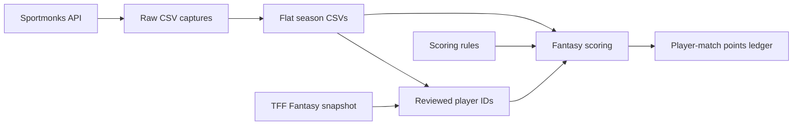

# Data pipeline

I use Sportmonks as the main source for Süper Lig matches and player statistics. A separate TFF Fantasy snapshot supplies positions, prices, and fantasy totals.

I wanted tables that could support several analyses with the same fixture, team, and player IDs. Two decisions mattered. I kept provider captures so I could rebuild the tables from saved inputs, and I kept uncertain player matches visible for review so a bad join would not assign fantasy prices or positions to the wrong person.

**Skills demonstrated** · REST API ingestion · Pagination and caching · ETL · Entity resolution · Data quality checks



## Fetch season data

Set `SPORTMONKS_API_TOKEN` in your environment or in a local `.env` file. The [Sportmonks downloader](../../src/fetch/download_season.py) discovers the season ID and fetches the schedule, fixtures, teams, squads, events, lineups, and available statistics. It saves provider captures in `data/raw/sportmonks/`. The [CSV exporter](../../src/fetch/export_csv.py) separates nested responses into tables joined by fixture, team, and player IDs under `data/final/sportmonks/<season>/`. Optional feeds that are unavailable appear in `unavailable.csv`.

```sh
python -m src.fetch.download_season --season 2025/2026
```

## Match players and score fixtures

Supply a TFF Fantasy CSV with `player_name`, `team_name`, and `position`. Include the TFF total-points field `tp` to reconcile the reconstructed totals. The [player matcher](../../src/fetch/update_tff_players.py) generates reports and prepares a `player_overrides.csv` file for unresolved names under `data/temp/tff_fantasy/2025-2026/` for the example below. Fill in each reviewed Sportmonks player ID and rerun the matcher to apply it.

```sh
python -m src.fetch.update_tff_players --season 2025/2026 --snapshot data/raw/tff_fantasy/players.csv
python -m src.points.run --seasons 2025/2026
```

The [scoring ledger](../../src/points/run.py) applies the [TFF scoring rules](../../config/tff_scoring_rules.csv), excludes fixtures that were awarded without play, and writes player-match and season totals under `data/final/points/`. Reconciliation, run settings, and input hashes are saved under `data/temp/points/runs/`. Use `--reconcile-before YYYY-MM-DD` when the snapshot predates the last fixtures in the season data.

## Prepare analysis and assistant inputs

```sh
python -m src.spider.build_spider_stats --all-seasons
python -m src.spider.radar_reliability
python -m src.chat.build_chat_db
```

The radar report measures whether early-season player rankings hold up over the rest of the season. The assistant database builder loads the saved season CSVs into SQLite for football statistics queries. [Player analysis](player-analysis.md) · [AI assistant](ai-assistant.md)

## How I checked it

I tested that overlapping schedule entries resolve to a single fixture and that merging xG data preserves existing player statistics. The identity tests check the use of display names, flag players who have left the league, and send unknown names to review. [Season tests](../../tests/test_season.py) · [Player matching tests](../../tests/test_update_tff_players.py)

## Read the code

- `Client.get()` applies a request budget and stores responses in a local cache. [Sportmonks client](../../src/fetch/sportmonks.py#L59)
- `export_tables()` takes the captured fixtures and resources and produces tables keyed by fixture, player, and team. [Normalization](../../src/fetch/export_csv.py#L25)
- `match_snapshot()` joins the fantasy snapshot to Sportmonks player identities using club, name, and reviewed overrides. The results feed the scoring ledger. [Player matching](../../src/fetch/update_tff_players.py#L333) · [Fantasy scoring and XI optimization](fantasy-scoring-and-xi-optimization.md)
