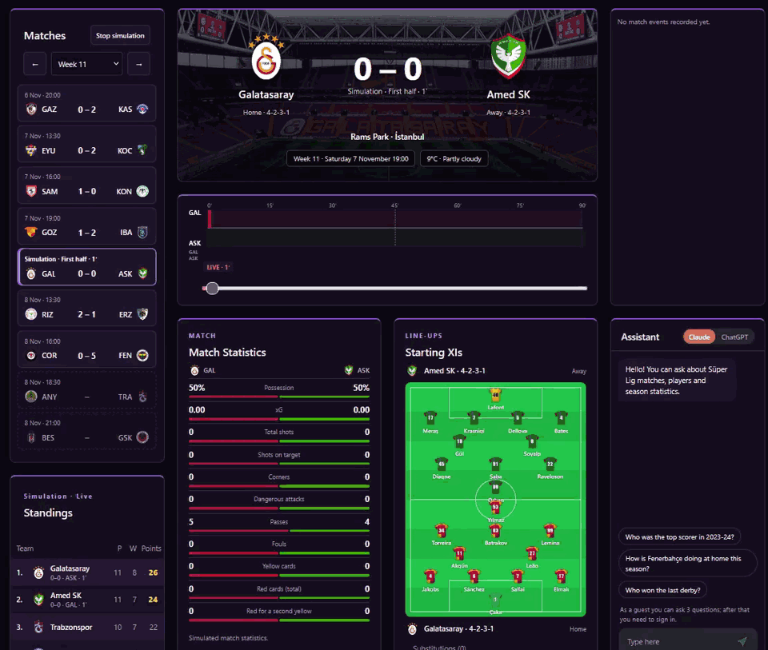

# Fantasy football dashboards

I built the dashboard to help TFF Fantasy players move from a question about a match or player to a lineup decision. A visitor can compare a player with positional peers, assess the next opponent’s attacking and defensive profile, and use the fantasy views to weigh expected points against squad constraints. [Explore the live website](https://fantezianaliz.com/)

**Skills demonstrated** · Sportmonks API integration · Data visualization · Preparing data for dashboards

The recording shows a local simulation of the match view. The score, match events, and available statistics update as the replay advances.

## How I fetched live match data

I built a Python poller for the local live dashboard. It sends an authenticated `GET /v3/football/livescores/inplay` request to the Sportmonks API, filters by league, and checks the returned fixtures against the configured season. The poller requests scores, match periods, events, and team statistics, then turns the nested JSON into a CSV snapshot the dashboard can render. [In-play API request](../../src/fetch/live.py#L142) · [Response normalization](../../src/fetch/live.py#L220)

I cache the snapshot in memory so multiple dashboard refreshes can reuse one fetch. The poller uses a longer interval when no matches are live and backs off when Sportmonks rate-limits the request. The dashboard gets a status and a retry delay in the same snapshot. [Polling and caching](../../src/fetch/live.py#L418) · [Live data walkthrough](live-match-data.md)

## Python behind the views

- **Player and club comparisons.** I prepare player and team match data for the radar and use a separate analysis to check whether early-season player rankings hold up. [Chart inputs](../../src/spider/build_spider_stats.py#L58) · [Player analysis](player-analysis.md)
- **Fantasy decisions.** The scoring ledger provides historical points by appearance. The optimizer takes projected points and prices and returns an XI within the user’s constraints. [Scoring and XI optimization](fantasy-scoring-and-xi-optimization.md)
