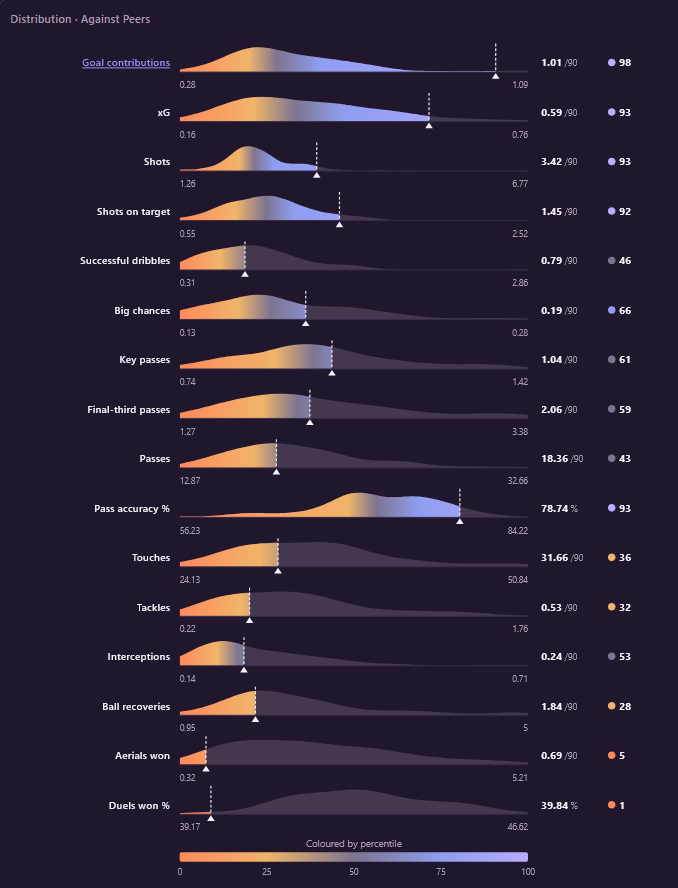
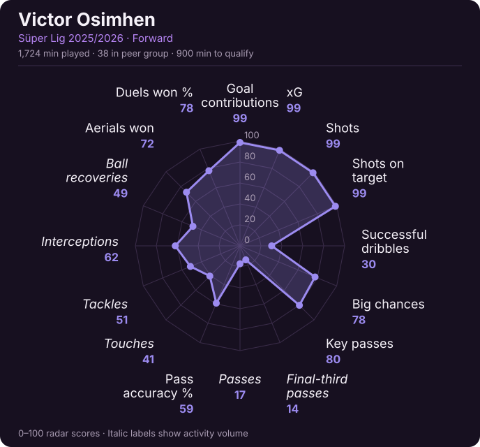
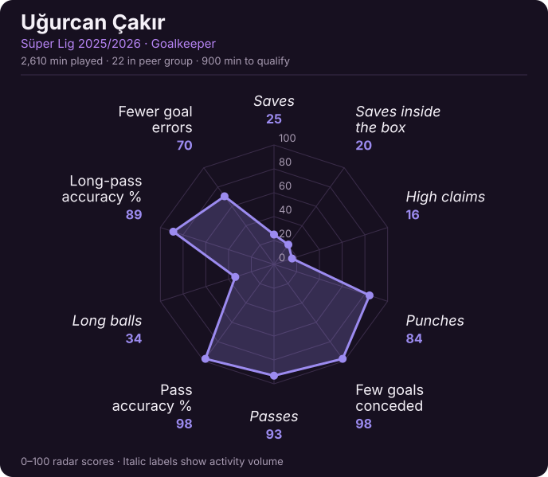

# Player analysis and visualizations

I designed the charts around questions a fantasy manager can act on. How does a player compare with peers? Which teams create and concede more chances? How early in the season is there enough evidence to trust a ranking?

**Skills demonstrated** · Exploratory data analysis · Data visualization · Peer-group benchmarking · Small-sample adjustment · Rank analysis

## My approach

- The player distribution shows the underlying statistic and its percentile among peers. The team scatter plot compares expected goals created and conceded per match. The stacked bars show how each club’s fantasy points are distributed across positions.
- For player radars, I checked the effect of sample size by comparing the first 4, 7, 10, or 15 rounds of completed seasons with the remaining fixtures in those seasons. I grouped players by position and compared their raw early-season rates with rates adjusted toward a peer average.
- I used minutes for per-90 rates and attempts for percentages. The reliability report compares the two approaches using Spearman rank correlation and average absolute percentile error, broken down by position and metric.



## Detailed player spider plots

The Detailed Metrics wheel shows 16 football statistics for outfield players and 10 for goalkeepers. The examples below use saved 2025/26 Süper Lig data. Each player is scored against eligible players from the same season and position group. In both examples, players needed at least 900 minutes to enter the peer group.

I convert counts to per-90 rates and calculate percentages from total successes and attempts. Where there are enough peers, I pull rates toward the group average before ranking them, with more adjustment for shorter samples. The plotted numbers are 0–100 scores. Italic labels mark activity measures, such as saves or passes, where a high score means more activity.

### Victor Osimhen · Forward



### Uğurcan Çakır · Goalkeeper



### Export from saved data

Run from the repository root with Python and Node.js. Point `--data-root` at the folder containing `sportmonks/<season>/fixtures.csv` and `spider/<season>/spider_stats.csv`. `--player-id` takes the Sportmonks ID. Osimhen is `455805` and Çakır is `201739`.

```sh
python -m src.spider.export_player_radar --season 2025/2026 --player-id 455805 --data-root path/to/data/final --output osimhen.svg
```

## How I checked it

The tests cover the distinction between a covered match with an omitted zero and missing data, minimum attempts for percentage statistics, and exclusion of incomplete seasons. [Reliability tests](../../tests/test_radar_reliability.py)

I also compared both exports with the original website scorer using the same season-only peer groups. The observed rates, adjusted rates, and scores matched across all 26 axes.

## Read the code

- `prepare_season()` combines the player and team match statistics used for radar inputs. [Chart data preparation](../../src/spider/build_spider_stats.py#L58)
- `season_inputs()` reads the saved CSVs, scopes the fixtures to the Süper Lig, and groups appearances by player ID for the exporter. [Python export](../../src/spider/export_player_radar.py#L17)
- `createReference()` builds the peer group and its adjusted reference values. `evaluate()` ranks one player on each metric. The same standalone module contains the original site’s SVG renderer. [Peer group](../../src/spider/player_radar.cjs#L375) · [Metric scoring](../../src/spider/player_radar.cjs#L469) · [SVG rendering](../../src/spider/player_radar.cjs#L515)
- `build()` compares early-season rates with later results and reports the effect of the adjustment by position and metric. [Reliability analysis](../../src/spider/radar_reliability.py#L311)
